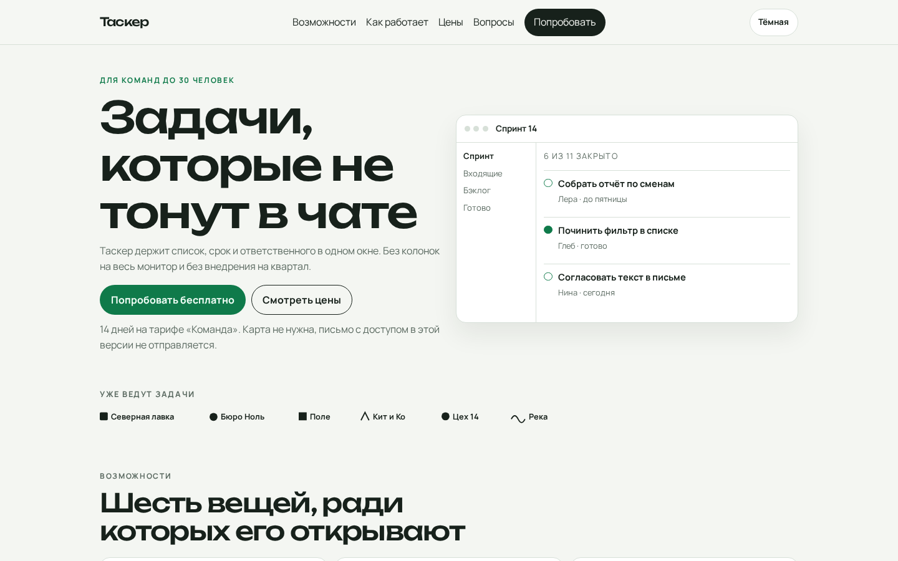
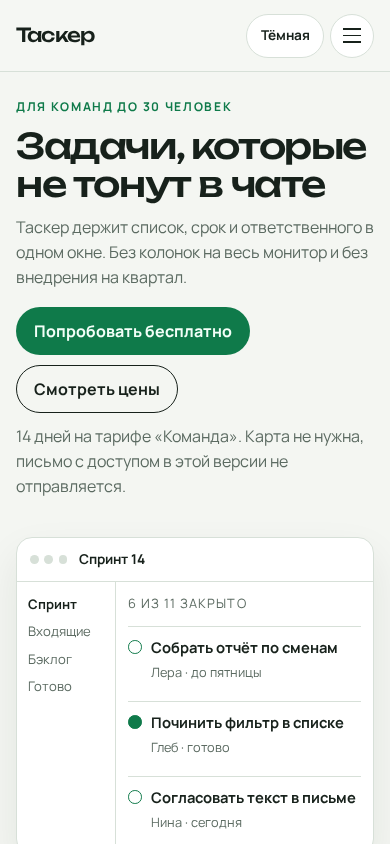

# Таскер — лендинг сервиса задач

Страница вымышленного сервиса «Таскер» для команд до 30 человек. Она объясняет, чем список задач отличается от чата, сравнивает три тарифа и собирает почту на пробные 14 дней. Письмо не отправляется: успех показывается на странице.

Демо: https://swattt555333.github.io/saas-landing/

## Скриншоты





## Что реализовано

- Герой с заголовком, двумя кнопками и мокапом интерфейса. Мокап собран из блоков HTML и CSS: боковое меню, прогресс спринта и три задачи. Это не картинка.
- Ряд SVG-логотипов вымышленных команд: «Северная лавка», «Бюро Ноль», «Поле», «Кит и Ко», «Цех 14», «Река».
- Шесть карточек возможностей, у каждой своя SVG-иконка.
- Блок «Как это работает» из трёх шагов.
- Переключатель «Месяц / Год −20%». В годовом режиме цена на карточке становится месячной со скидкой 20%, а строка под ней показывает сумму за год. База: Старт 490 ₽, Команда 1 490 ₽, Мастерская 3 990 ₽.
- Таблица сравнения тарифов. На узком экране она уезжает в горизонтальный скролл, не ломая страницу.
- Шесть интеграций с SVG-иконками: почта, календарь, чат, таблицы, файлы, вебхуки.
- Три отзыва и FAQ-аккордеон.
- Форма «Попробовать бесплатно»: проверка почты и сообщение об успехе вместо отправки.
- Переключатель светлой и тёмной темы. Выбор пишется в `localStorage` под ключом `tasker-theme` и читается до отрисовки, чтобы не мигала светлая тема.
- Бургер до 1024px, закреплённая шапка, якоря, появление секций через `IntersectionObserver`.

## Стек

HTML5, CSS3 и ванильный JavaScript. Шрифты Unbounded и Manrope с Google Fonts, параметр `display=swap`. Без фреймворков и сборщиков.

## Структура

```text
saas-landing/
├── index.html                 лендинг Таскера
├── css/style.css              светлая и тёмная палитры, мокап, таблица, цены
├── js/main.js                 меню, тема, пересчёт цен, аккордеон, форма
├── img/favicon.svg            значок вкладки
├── img/screenshot-desktop.png первый экран 1440×900
├── img/screenshot-mobile.png  первый экран 390×844
└── README.md
```

## Как запустить локально

1. Сохраните папку `saas-landing`.
2. Откройте `index.html` двойным щелчком.
3. Переключите тему и период оплаты: оба состояния живут в браузере, сервер не нужен. Тема запоминается после обновления страницы.

## Автор

InterPanic
